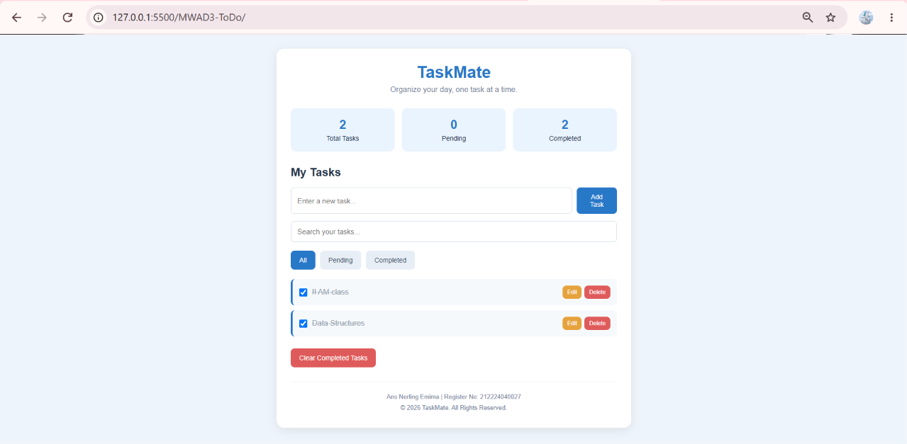

# Ex03 To-Do List using JavaScript
## Date:17/11/2026

## AIM
To create a To-do Application with all features using JavaScript.

## ALGORITHM
### STEP 1
Build the HTML structure (index.html).

### STEP 2
Style the App (style.css).

### STEP 3
Plan the features the To-Do App should have.

### STEP 4
Create a To-do application using Javascript.

### STEP 5
Add functionalities.

### STEP 6
Test the App.

### STEP 7
Open the HTML file in a browser to check layout and functionality.

### STEP 8
Fix styling issues and refine content placement.

### STEP 9
Deploy the website.

### STEP 10
Upload to GitHub Pages for free hosting.

## PROGRAM

index.html

```

<!DOCTYPE html>
<html lang="en">
<head>
    <meta charset="UTF-8">
    <meta name="viewport" content="width=device-width, initial-scale=1.0">
    <title>TaskMate - My Daily Tasks</title>
    <link rel="stylesheet" href="style.css">
</head>
<body>

    <div class="container">

        <header>
            <h1>TaskMate</h1>
            <p>Organize your day, one task at a time.</p>
        </header>

        <section class="dashboard">
            <div class="stat-card">
                <h3 id="totalTasks">0</h3>
                <p>Total Tasks</p>
            </div>

            <div class="stat-card">
                <h3 id="pendingTasks">0</h3>
                <p>Pending</p>
            </div>

            <div class="stat-card">
                <h3 id="completedTasks">0</h3>
                <p>Completed</p>
            </div>
        </section>

        <section class="task-section">

            <h2>My Tasks</h2>

            <div class="input-area">
                <input type="text" id="taskInput"
                    placeholder="Enter a new task...">

                <button onclick="addTask()">Add Task</button>
            </div>

            <input type="text" id="searchInput"
                placeholder="Search your tasks..."
                oninput="displayTasks()">

            <div class="filters">
                <button class="filter active"
                    onclick="setFilter('all', this)">All</button>

                <button class="filter"
                    onclick="setFilter('pending', this)">Pending</button>

                <button class="filter"
                    onclick="setFilter('completed', this)">Completed</button>
            </div>

            <ul id="taskList"></ul>

            <p id="emptyMessage">No tasks available. Add your first task!</p>

            <button class="clear-btn" onclick="clearCompleted()">
                Clear Completed Tasks
            </button>

        </section>

        <footer>
            <p>Ans Nerling Emima | Register No: 212224040027</p>
            <p>© 2026 TaskMate. All Rights Reserved.</p>
        </footer>

    </div>

    <script src="script.js"></script>
</body>
</html>

```
style.css

```

* {
    margin: 0;
    padding: 0;
    box-sizing: border-box;
}

body {
    font-family: Arial, sans-serif;
    background: #eef4fb;
    color: #26344a;
    padding: 30px 15px;
}

.container {
    max-width: 750px;
    margin: auto;
    background: white;
    border-radius: 16px;
    padding: 30px;
    box-shadow: 0 5px 20px rgba(0, 0, 0, 0.08);
}

header {
    text-align: center;
    margin-bottom: 30px;
}

header h1 {
    color: #2878c8;
    font-size: 35px;
    margin-bottom: 8px;
}

header p {
    color: #718096;
}

.dashboard {
    display: grid;
    grid-template-columns: repeat(3, 1fr);
    gap: 15px;
    margin-bottom: 30px;
}

.stat-card {
    background: #eaf4ff;
    padding: 20px 10px;
    border-radius: 12px;
    text-align: center;
}

.stat-card h3 {
    color: #2878c8;
    font-size: 26px;
}

.stat-card p {
    margin-top: 5px;
    font-size: 14px;
}

.task-section h2 {
    margin-bottom: 18px;
}

.input-area {
    display: flex;
    gap: 10px;
    margin-bottom: 15px;
}

input {
    width: 100%;
    padding: 13px;
    border: 1px solid #d5dfeb;
    border-radius: 8px;
    font-size: 15px;
    outline: none;
}

input:focus {
    border-color: #2878c8;
}

button {
    border: none;
    border-radius: 8px;
    padding: 12px 18px;
    background: #2878c8;
    color: white;
    cursor: pointer;
    font-size: 14px;
}

button:hover {
    background: #185fa5;
}

#searchInput {
    margin-bottom: 18px;
}

.filters {
    display: flex;
    gap: 10px;
    margin-bottom: 20px;
}

.filter {
    background: #e8eef5;
    color: #42536b;
}

.filter.active {
    background: #2878c8;
    color: white;
}

#taskList {
    list-style: none;
}

.task-item {
    display: flex;
    align-items: center;
    justify-content: space-between;
    gap: 12px;
    background: #f6f9fc;
    padding: 14px;
    margin-bottom: 10px;
    border-radius: 9px;
    border-left: 4px solid #2878c8;
}

.task-info {
    display: flex;
    align-items: center;
    gap: 10px;
    flex: 1;
    min-width: 0;
}

.task-info span {
    overflow-wrap: anywhere;
}

.task-info input {
    width: 17px;
    height: 17px;
    cursor: pointer;
}

.completed span {
    text-decoration: line-through;
    color: #929eac;
}

.actions {
    display: flex;
    gap: 6px;
}

.actions button {
    padding: 7px 10px;
    font-size: 12px;
}

.edit-btn {
    background: #e6a23c;
}

.delete-btn {
    background: #df5b5b;
}

#emptyMessage {
    text-align: center;
    color: #8492a6;
    padding: 20px 5px;
}

.clear-btn {
    background: #df5b5b;
    margin-top: 15px;
}

footer {
    text-align: center;
    border-top: 1px solid #e4eaf1;
    margin-top: 30px;
    padding-top: 20px;
    color: #718096;
    font-size: 13px;
    line-height: 1.8;
}

@media (max-width: 550px) {
    .container {
        padding: 20px;
    }

    .dashboard {
        gap: 8px;
    }

    .stat-card {
        padding: 15px 5px;
    }

    .input-area {
        flex-direction: column;
    }

    .task-item {
        align-items: flex-start;
        flex-direction: column;
    }

    .actions {
        align-self: flex-end;
    }
}

```
script.js

```

let tasks = JSON.parse(localStorage.getItem("taskMateTasks")) || [];
let currentFilter = "all";

function saveTasks() {
    localStorage.setItem("taskMateTasks", JSON.stringify(tasks));
}

function addTask() {
    const input = document.getElementById("taskInput");
    const taskText = input.value.trim();

    if (taskText === "") {
        alert("Please enter a task!");
        return;
    }

    tasks.push({
        id: Date.now(),
        text: taskText,
        completed: false
    });

    input.value = "";
    saveTasks();
    displayTasks();
}

function toggleTask(id) {
    tasks = tasks.map(task =>
        task.id === id
            ? { ...task, completed: !task.completed }
            : task
    );

    saveTasks();
    displayTasks();
}

function editTask(id) {
    const task = tasks.find(task => task.id === id);
    const newText = prompt("Edit your task:", task.text);

    if (newText !== null && newText.trim() !== "") {
        task.text = newText.trim();
        saveTasks();
        displayTasks();
    }
}

function deleteTask(id) {
    if (confirm("Are you sure you want to delete this task?")) {
        tasks = tasks.filter(task => task.id !== id);
        saveTasks();
        displayTasks();
    }
}

function setFilter(filter, button) {
    currentFilter = filter;

    document.querySelectorAll(".filter").forEach(btn => {
        btn.classList.remove("active");
    });

    button.classList.add("active");
    displayTasks();
}

function displayTasks() {
    const taskList = document.getElementById("taskList");
    const searchText = document.getElementById("searchInput")
        .value.toLowerCase();

    taskList.innerHTML = "";

    let filteredTasks = tasks.filter(task => {
        const matchesSearch = task.text.toLowerCase().includes(searchText);

        if (currentFilter === "pending") {
            return matchesSearch && !task.completed;
        }

        if (currentFilter === "completed") {
            return matchesSearch && task.completed;
        }

        return matchesSearch;
    });

    filteredTasks.forEach(task => {
        const li = document.createElement("li");
        li.className = "task-item";

        const taskInfo = document.createElement("div");
        taskInfo.className = "task-info";

        if (task.completed) {
            taskInfo.classList.add("completed");
        }

        const checkbox = document.createElement("input");
        checkbox.type = "checkbox";
        checkbox.checked = task.completed;
        checkbox.addEventListener("change", () => toggleTask(task.id));

        const span = document.createElement("span");
        span.textContent = task.text;

        taskInfo.appendChild(checkbox);
        taskInfo.appendChild(span);

        const actions = document.createElement("div");
        actions.className = "actions";

        const editButton = document.createElement("button");
        editButton.textContent = "Edit";
        editButton.className = "edit-btn";
        editButton.addEventListener("click", () => editTask(task.id));

        const deleteButton = document.createElement("button");
        deleteButton.textContent = "Delete";
        deleteButton.className = "delete-btn";
        deleteButton.addEventListener("click", () => deleteTask(task.id));

        actions.appendChild(editButton);
        actions.appendChild(deleteButton);

        li.appendChild(taskInfo);
        li.appendChild(actions);

        taskList.appendChild(li);
    });

    document.getElementById("emptyMessage").style.display =
        filteredTasks.length === 0 ? "block" : "none";

    updateDashboard();
}

function updateDashboard() {
    const total = tasks.length;
    const completed = tasks.filter(task => task.completed).length;
    const pending = total - completed;

    document.getElementById("totalTasks").textContent = total;
    document.getElementById("pendingTasks").textContent = pending;
    document.getElementById("completedTasks").textContent = completed;
}

function clearCompleted() {
    tasks = tasks.filter(task => !task.completed);
    saveTasks();
    displayTasks();
}

document.getElementById("taskInput").addEventListener("keydown", event => {
    if (event.key === "Enter") {
        addTask();
    }
});

displayTasks();

```

## OUTPUT


## RESULT
The program for creating To-do list using JavaScript is executed successfully.
